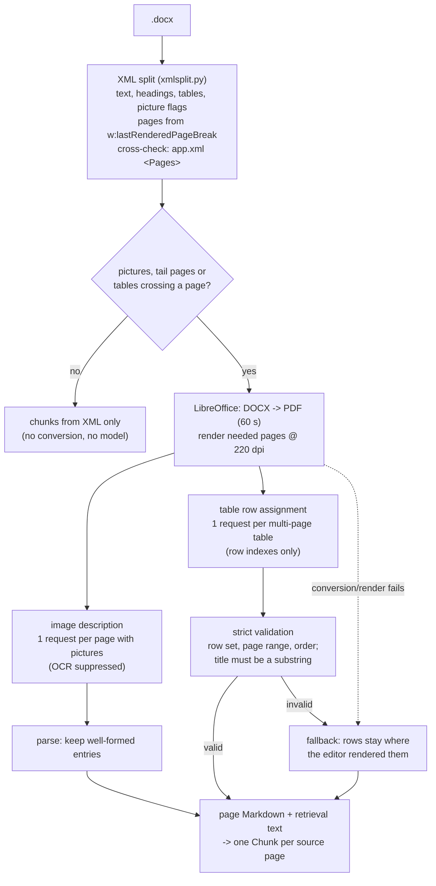

# DOCX: specification documents

`vlmrag.techniques.docx` turns a Word `.docx` specification into one retrieval chunk per
**source page**. Text and tables come straight from the WordprocessingML; page boundaries come
from the markers the author's word processor left in the file; a vision-language model (VLM)
adds only what the XML cannot say: what the pictures show, and on which page each row of a
long table was drawn.

```bash
python -m vlmrag.synthetic --out work/synth --only docx
vlmrag run docx work/synth/docx --out work/docx.jsonl
python examples/docx_demo.py --provider null        # synthetic specification, offline
```

The chunk format, the VLM client (retries, cache, record/replay, usage), rendering and the
batch runner are shared by all techniques and described in [common.md](common.md). The other
techniques: [drawing](drawing.md), [slides](slides.md). Code: `src/vlmrag/techniques/docx/`,
fixture generator `src/vlmrag/synthetic/docx.py`, demo
[`examples/docx_demo.py`](../../examples/docx_demo.py).

---

## 1. The problem

Specifications are text, tables and pictures, and people search them by page: "the torque
table on page 12", "the wiring diagram in section 4". A good ingestion keeps exact text,
keeps tables intact, makes pictures searchable, and gives every chunk the page number a
reader would see.

The obvious approach - convert to PDF, render every page, let a VLM read it - fails on all
four counts:

* **Page drift.** A DOCX has no fixed pages. LibreOffice paginates differently from the
  author's word processor (fonts, kerning, widow/orphan rules), so "page 7" of the converted
  PDF is not page 7 of the document the author sees.
* **OCR errors in the values that matter.** Part numbers, tolerances and codes in tables are
  re-read from pixels and come back with swapped characters, even though the XML holds them
  exactly.
* **Tables lose their structure** (merged cells, highlights and page breaks confuse a reader
  that only sees pixels).
* **Cost.** Every page is sent to the model, although most pages are plain text.

The technique therefore inverts the roles: **the XML is the source of truth for text, tables
and pages; the model only looks at pictures and at page geometry it cannot get otherwise.**

## 2. Pipeline



Image requests and table requests are independent, so they all go into one thread pool
(10 workers) at the same time; the client's semaphore (`VLMRAG_MAX_CONCURRENCY`) decides how
many are actually in flight. Results are folded back in a fixed order, so the output does not
depend on which call finished first.

### 2.1 XML split (`xmlsplit.py`)

`word/document.xml` is streamed with `lxml.etree.iterparse` (entity resolution and network
access off; parts larger than 256 MB are refused). The main part is located through
`_rels/.rels`, so packages that do not keep it at `word/document.xml` still work.

| XML | becomes |
|---|---|
| top-level `w:p` | a paragraph block; `w:tab` -> tab, `w:br`/`w:cr` -> line break |
| `w:pStyle` *Title*, *Subtitle*, *heading N* | a heading block (`##` for title and level 1, `###` for level 2, ...); the first heading on a page is `page_title`, the second `section_title`. Style ids are also resolved through `styles.xml` names, because localized editors write localized ids but keep the built-in English names |
| top-level `w:tbl` | rows of cell texts (cell paragraphs joined by spaces, nested tables flattened into their cell, blank rows dropped); a table that starts and ends on one page becomes one table block, and its first row fills `table_header_hint` |
| `w:drawing`, `w:pict`, `w:object` | the page "has pictures" (counted per page) |
| `w:lastRenderedPageBreak` | page boundary (rendered) |
| `w:br w:type="page"` | page boundary (manual) |
| `mc:Fallback` | skipped: it repeats the `mc:Choice` content for old readers |
| text-box paragraphs inside a paragraph | joined into their host paragraph |
| `w:delText`, `w:instrText` | ignored (deleted text, field codes) |

**A page boundary in the middle of a paragraph** splits it: the text before the marker stays
on the earlier page, the rest goes to the next one. A boundary before the paragraph's first
character moves the whole paragraph. Pictures are counted on the page where they occur.

**Inside a table row**, cells are laid out side by side, so a row that starts (or continues) on
a new page can carry a marker in every cell. A row crosses as many boundaries as its
most-broken cell; the other cells' markers are merged (`merged_breaks`).

**Tables that cross a boundary** are not placed by the splitter. A table starts on the page
where its first row's text was rendered - a table that begins at the top of a page has its
marker inside the first cell, after `<w:tbl>` opened, and is a single-page table. For a table
whose first and last rows are on different pages, the splitter records a `MultiPageTable`
(rows, start and end page, the page each row was last rendered on, and the last five
paragraphs before the table) and leaves a `table_slot` block where the table ends.

### 2.2 Image descriptions (pages with pictures)

One request per page: the prompt, `"Page context: page N of M."` and the page render. The
prompt tells the model that the page text was already extracted from the XML and must not be
transcribed again; it describes only pictures (diagrams, photos, flowcharts, drawings,
charts, icons, embedded-object previews), including labels that exist only inside a picture,
and answers

```json
{"image_descriptions": [{"location_hint": "centre diagram", "description": "..."}], "notes": ""}
```

Entries without a description are dropped; a non-empty `notes` becomes one more entry.

### 2.3 Table row assignment (tables crossing pages)

One request per table: the prompt, `"Document context: table spans pages S-E of M total."`,
the XML rows as JSON (`{"index": i, "cells": [...]}` plus the preceding paragraphs), and one
image per page of the span, each labelled `PDF page N image follows:`. The model returns

```json
{"has_title": true, "title_text": "Table 1. ...", "title_source": "preceding_paragraph",
 "title_confidence": "high", "row_distribution": {"2": [0, 1, 2], "3": [3, 4]}}
```

It never returns cell text. The strict JSON schema spells out the page keys of this table's
span, so a strict-mode server cannot omit a page or invent one.

### 2.4 Assembly and chunks (`assemble.py`, `pipeline.py`)

* The slice of rows for a table's last page replaces its `table_slot` in place (text after the
  table stays after it); slices for earlier pages are appended to those pages.
* A slice that does not start with row 0 is a continuation: it starts with
  `(Table continued from page S)` - plus the validated title, if any - and its first data row
  is not promoted to a Markdown header.
* Visual descriptions are appended after the page's XML content under
  `### Visual content (image description)` (Markdown) / `[Visual content]` (retrieval text).
* Pages with neither text nor described pictures produce no chunk. Page numbers are never
  shifted to close the gap.

## 3. Why it is built this way

**Why the editor's rendered breaks.** When a paginating word processor saves a file, it
records `w:lastRenderedPageBreak` wherever its layout started a new page. Those markers are
the author's own pagination - exactly what a reader and a viewer show - and reading them costs
nothing. Converting the file and reading pages back would reintroduce the drift this design
exists to avoid.

**Why app.xml `<Pages>` as the cross-check.** The editor also stores its page count. The usual
mismatch is a last page that holds only a picture: no paragraph text, so no marker. When the
split comes up short, visual-only placeholder pages are appended up to `<Pages>`; they are
rendered and described like any page with pictures, so the content is recovered and keeps a
real page number. When the split finds *more* pages than `<Pages>` (a stale count), the split
is kept and the mismatch is recorded.

**Why a manual break followed by a rendered marker counts once.** Editors record a rendered
marker at the top of a page that a manual break started. Treating both as boundaries would
insert a phantom blank page and shift every later page by one, so a rendered marker with no
content since a manual break is merged into it (`merged_breaks` in provenance).

**Files without rendered breaks (decision).** Files written by libraries, converters or
editors that do not record pagination carry no `w:lastRenderedPageBreak`. The technique then
splits on manual page breaks only (`mode="explicit"`), or treats the whole body as page 1 when
there are none (`mode="none"`), and still pads to `<Pages>`. It deliberately does **not**
re-paginate text with LibreOffice: that would mix the converter's pagination with the
author's and silently produce page numbers no reader sees. Instead the condition is made
visible: every chunk carries `metadata.page_split` and the fallback
`no_rendered_page_breaks:<mode>`, and a warning is logged. Opening and re-saving such a file
in a paginating word processor writes the markers and restores exact pages.

**Why OCR is suppressed in the image pass.** The page text is already exact. A second,
model-transcribed copy would contain misreadings that compete with the real text at
retrieval time, and it costs output tokens. Only words that exist *inside* a picture are
wanted, because the XML does not contain them.

**Why the table answer is indexes only.** An index answer can be checked completely: every
row exactly once, every page inside the span, rows in page order. A cell-text answer could
only be compared fuzzily, and a "nearly right" table is worse than an obviously wrong one.

**Why all-or-nothing validation with a deterministic fallback.** A partially valid assignment
cannot be repaired without guessing. Rejecting it and using the rows' rendered pages (taken
from markers inside the table while splitting) gives an answer that is reproducible and
exact whenever the file's markers are current. The model's answer is still preferred when it
validates, because markers can be stale after edits and the model sees the actual rendering.

**Why titles can only be dropped.** A table title is searchable text. It is accepted only if
its confidence is above `"low"` and it really occurs (ignoring case and spacing) in the
preceding paragraph or first row the model names. Anything else drops the title, never the
row assignment.

**Why the PDF is optional.** LibreOffice is needed only for pictures, tail pages and tables
that cross pages; text-only documents never start it. If it is missing or fails, chunks are
still produced from the XML, with every enrichment's fallback recorded.

## 4. Defaults

| setting | value | where |
|---|---|---|
| render resolution | 220 dpi | `pipeline.RENDER_DPI` |
| DOCX -> PDF timeout | 60 s per LibreOffice binary | `pipeline.CONVERT_TIMEOUT_S` |
| VLM request timeout | 600 s | `pipeline.VLM_TIMEOUT_S` |
| max output tokens | 60,000 per call (reasoning tokens count against it) | `pipeline.MAX_OUTPUT_TOKENS` |
| reasoning effort | `low` for images, `medium` for tables; none if `VLMRAG_REASONING_EFFORT` is empty | `pipeline.*_REASONING_EFFORT` |
| re-ask on empty / non-JSON answer | 1 (two attempts per call) | `pipeline.PARSE_RETRIES` |
| transport retries | client default (`VLMRAG_MAX_RETRIES`, 3) | `VLMClient` |
| thread-pool width | 10; in-flight requests capped by `VLMRAG_MAX_CONCURRENCY` | `pipeline.PARALLELISM` |
| title candidates per table | last 5 paragraphs before it | `xmlsplit.PRECEDING_PARAGRAPHS` |
| `table_header_hint` length | 200 characters | `xmlsplit.HEADER_HINT_LIMIT` |
| prompt versions | `docx.image_description/1`, `docx.table_distribution/1` | `prompts.py` |

## 5. Validation and fallbacks

Every fallback is recorded in `provenance["fallbacks"]` of the affected chunks.

| situation | what happens | recorded as |
|---|---|---|
| no `w:lastRenderedPageBreak` in the body | split on manual breaks, else one page | `no_rendered_page_breaks:explicit` / `:none` |
| split shorter than app.xml `<Pages>` | visual-only tail pages appended | `app_xml_tail_padding`, `app_xml_tail_page` |
| split longer than `<Pages>` | split kept | `page_count_exceeds_app_xml` |
| LibreOffice missing, failing or timing out; PDF unreadable | no visuals; tables use row markers | `pdf_unavailable` |
| PDF page count differs from the split | renders used by page number anyway | `pdf_page_count_mismatch` |
| page with pictures beyond the PDF | not described | `image_page_not_rendered` |
| image call fails (API error after retries) | no visuals for that page | `image_description_failed` |
| image answer empty or not JSON (after one re-ask) | no visuals | `image_description_unparseable` |
| image answer is JSON of the wrong shape (e.g. `{}`) | no visuals | `image_description_invalid` |
| table call fails | rows from markers | `table_rows_from_xml_markers:<id>:table_distribution_failed` |
| table answer empty or not JSON (after one re-ask) | rows from markers | `...:table_distribution_unparseable` |
| `row_distribution` missing or not an object; non-integer page key; page outside the span; value not a list; non-integer (or boolean, or fractional) row index; duplicate row; missing or extra row; rows not in page order | the whole assignment is rejected, rows from markers | `...:table_distribution_invalid:<reason>` |
| no page of a table's span rendered | rows from markers | `...:table_pages_not_rendered` |
| title not found in its claimed source | title dropped, rows kept | `table_title_rejected:<id>` |
| title confidence `low`, unknown source/confidence, `has_title` not `true` | title ignored | - |
| file is not a zip (the message says when it is an OLE compound file: a legacy `.doc` or an encrypted / rights-protected document), has unreadable or encrypted members, has no main part, or has malformed XML | `DocxExtractionError` (the CLI records it per file) | - |
| no page has any content | `DocxExtractionError` | - |

## 6. Output

One `Chunk` per non-empty source page:

| field | content |
|---|---|
| `page` | 1-based source page (editor pagination; see section 3 for files without markers) |
| `chunk_index` | 0-based position among this document's chunks |
| `retrieve_content` | `"<stem> - page N"` line, then paragraphs, headings, tables as `a \| b \| c` rows (with continuation notes) and `[Visual content]` lines |
| `llm_content` | `"# <stem> - page N"`, then headings as Markdown headings, tables as Markdown tables, `### Visual content (image description)` |
| `filtering_content` | `retrieve_content` without any whitespace |

`metadata`: `page_title`, `section_title`, `table_titles` (validated titles of tables with rows
on this page), `table_header_hint`, `has_images`, `image_count`, `visual_descriptions`
(`[{location_hint, description}]`), `is_table_heavy` (at least half of the page's blocks are
tables - a useful switch for the optional retrieval summary), `placeholder_page`,
`page_split` (`rendered` / `explicit` / `none`), `multi_page_tables`
(`[{table_id, rows, assignment: "vlm" | "xml_row_markers", continued_from, title}]`).

`provenance`: the shared keys (see [common.md](common.md#1-dual-representation)):
`technique`, `model`, `backend`, `prompt_versions` used for this page, `render` (`dpi`,
`converter`, `pdf_pages`), `fallbacks` and `calls` (`task`, `prompt_version`, `status`,
`pages`, `cached`, `latency_s`, `usage`, and `reason` / `error` when the answer was not used);
plus `page_split` (mode, rendered/manual/merged break counts, app.xml pages, XML pages, padded
pages). `status` is `ok`, `no_visuals` (a valid image answer with nothing to describe),
`unparseable`, `invalid` (with the validation `reason`) or `error` (the call failed after
retries); the fallback codes in the table above keep their more specific names. A table call
covers several pages, so it is listed on each of them with the same `pages` list; sum usage
from the client's usage table, not from chunks.

## 7. Limitations

* Pagination is exactly as current as the file's markers. A document edited by a tool that
  does not re-render keeps stale markers; the table pass can correct row placement, but the
  paragraph split cannot be corrected.
* Renders come from LibreOffice and are matched to source pages by number. When LibreOffice
  paginates differently, a picture may be described from a neighbouring page's render; the
  `pdf_page_count_mismatch` fallback flags the obvious cases, not every drift.
* Only `word/document.xml` is read: headers, footers, footnotes, endnotes and comments are not
  part of the chunks.
* Section breaks that start a new page and "page break before" paragraph properties are not
  read as manual breaks; with rendered markers present this does not matter, without them such
  pages merge into the previous one.
* A page made only of empty paragraphs right after a manual break, followed by a rendered
  marker, is merged into the manual break.
* Very long tables are sent in one request with all rows; tables spanning more than 90 pages
  are sent without a strict schema (the parser still validates).
* The answer decides only which page each row is on; rows listed for one page are put back in
  XML order.
* Pictures inside tables are described as part of the page, not attached to a cell.

## 8. Synthetic fixture and tests

`python -m vlmrag.synthetic --out work --only docx` writes `lantern_spec.docx` (a four-page
product specification with an exploded-view diagram, a power-path block diagram, a photo-like
render and a 44-row parts table that crosses a page) and `lantern_spec.truth.json` (page
count, row -> page mapping, picture pages, must-mention facts, and retrieval queries whose
answers exist only in the pictures). The generator writes the package by hand, renders a draft
with LibreOffice when it is installed, locates every paragraph and table row in the render and
writes `w:lastRenderedPageBreak` markers and `<Pages>` to match - the way a paginating editor
would. Without LibreOffice it estimates the layout from a height model
(`truth["layout_source"]`).

`tests/docx/` covers the split (boundaries, merging, padding, headings, text boxes, markup
compatibility, tables), answer validation, assembly, request structure and schemas, the
generator, end-to-end extraction with a scripted backend built from the truth file, every
failure path in the table above, and record/replay. Tests that need LibreOffice are marked
`soffice`.
