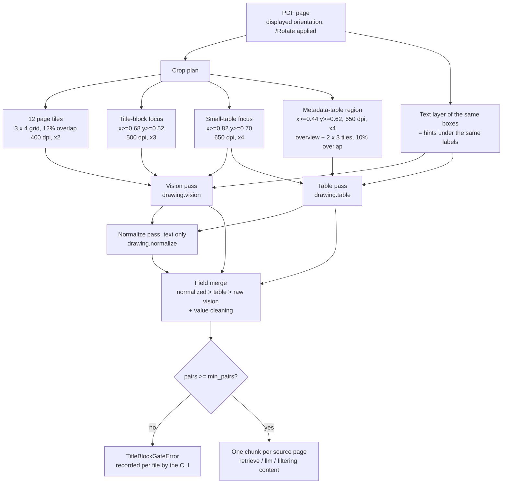

# Engineering drawings: title-block extraction

`vlmrag.techniques.drawing` turns engineering-drawing PDFs into one retrieval chunk per page.
The valuable, searchable information on a drawing sheet is its **title block**: drawing number,
title, revision, date, material, finish, sheet number and the small ruled tables around it. This
technique reads that block with a vision-language model and makes every fact in it findable.

```bash
python -m vlmrag.synthetic --out work/synth --only drawing
vlmrag run drawing work/synth/drawing --out work/drawing.jsonl
python examples/drawing_demo.py --simulate          # offline, scripted model answering from ground truth
python examples/drawing_demo.py --provider null     # offline dry run: every sheet fails the gate
```

The chunk format, the VLM client (retries, cache, record/replay, usage), rendering and the
batch runner are shared by all techniques and described in [common.md](common.md). The other
techniques: [slides](slides.md), [docx](docx.md). Code: `src/vlmrag/techniques/drawing/`,
fixture generator `src/vlmrag/synthetic/drawing.py`, demo
[`examples/drawing_demo.py`](../../examples/drawing_demo.py).

## 1. The problem

* **Tiny text on a huge page.** An A3 sheet is about 1190 x 842 pt; title-block labels use 4-6 pt
  type. Sent as one image, the page is downscaled by the provider until those glyphs are a few
  pixels high and the model starts guessing.
* **The text layer cannot be trusted alone.** Many drawings are flattened, scanned or have
  title blocks pasted in as images, so the values have no text layer at all. When a text layer
  exists, it is in content-stream order: labels and values from neighbouring cells interleave,
  and border zone markers (`E`, `F`, `7`, `8`) sit right next to the title block.
* **Every organisation prints different labels.** `Dwg. No.`, `Drawing Number`, `Document No.`
  and `Identification number` all mean the same field; some sheets have fields no schema
  anticipated.
* **Ruled tables invite cell mixing.** A model reading a dense grid readily attaches a value to
  the neighbouring label, or copies a label into a value.

## 2. Pipeline



The vision and table passes are independent and run concurrently from a thread pool; the
client's semaphore (`VLMRAG_MAX_CONCURRENCY`) bounds in-flight requests across files and pages.
The normalize pass needs both answers and runs afterwards.

## 3. Design decisions and why

**Multi-zoom crops instead of one page image.** Each zoom level answers a different question.
The page tiles guarantee coverage: nothing is missed when a sheet puts its title block
somewhere unusual, and the 12 % overlap means a value cut by a tile boundary appears whole in
at least one neighbour. The focus crops guarantee legibility where title blocks almost always
are (lower right), at higher DPI and with a larger enlargement because the text there is the
smallest. Rendering is done region by region (`PdfPages.render(..., bbox=...)`), so a 650 dpi
crop never requires a 650 dpi full-page bitmap.

**Render, then enlarge.** Each crop is rendered at its DPI and then enlarged with LANCZOS
(x2 / x3 / x4). Vision models tokenise images in fixed-size patches; enlarging makes a 4 pt glyph
span enough patches to be read reliably.

**A position label before every image.** Every image is preceded by a text part such as
`PAGE_TILE r3c4 bottom-right x=0.72-1.00 y=0.63-1.00 dpi=400` or
`TITLE_BLOCK_FOCUS lower-right x=0.68-1.00 y=0.52-1.00 dpi=500`. A model cannot know where a
crop came from; the label lets it reconcile overlapping tiles ("the same cell seen twice") and
lets the prompt state facts such as "title blocks usually sit in the lower-right area".
Coordinates are normalised on the *displayed* page, so a sheet stored portrait with `/Rotate 90`
gets the same labels as a native landscape sheet.

**Text-layer hints under the same labels.** For every image, the PDF text inside exactly the
same box is sent as a hint section headed by the image's label (plus one `FULL_PAGE` section).
The prompt says to use a hint only where it matches the image. This combines the strengths of
both sources: the text layer spells long part numbers perfectly, the image says which cell a
string belongs to and covers raster-only regions. Because the hint is region-matched, the model
can tell "this string belongs to this crop" instead of receiving one unordered dump.

**A dedicated table pass.** The ruled metadata table gets its own request with its own crops
(overview plus a 2 x 3 grid) and its own prompt, which asks for visually grouped
`table_rows` (row and column indexes plus cell text) *and* pairs. Asking for rows forces the
model to respect borders; the rows also become retrieval text (`ROW 2: B || Vent hole diameter
3.0 to 3.2 || 2026-01-20`) that answers "what changed in revision B?". The bottom-right
close-up is shared by both passes so the smallest cells are seen twice.

**A text-only normalization pass.** Label variety is too large for an alias table alone, but
mapping labels to fields needs no pixels. A third, cheap text-only request receives the raw
vision JSON, the table JSON, the table rows and the observed pairs, and maps them to the
canonical fields "by meaning and value pattern". Schema-specific confusions (two numbers that
look alike, two organisation fields) are listed as `normalize_rules` in the schema file.

**Field priority: normalized > table > raw vision.** The normalized answer saw both passes; the
table pass read the ruled cells with dedicated close-ups; the raw vision answer is the most
general. Each field takes the first non-empty cleaned value in that order, and the winning pass
is recorded in `provenance.field_sources`.

**Keep unmapped pairs.** Every visible topic-value pair is kept even when its label maps to no
canonical field: such pairs (a paint code, a finish per part, a seal specification) are often
the most specific facts on the sheet. Final pairs are the canonical pairs followed by all raw
and table pairs, de-duplicated on (normalised label, value) so two rows with the same label
but different values both survive.

**Value cleaning for table fields.** Fields marked `table_field` in the schema (material,
finish, tolerance, mass) live in the small ruled table where models copy labels and border
zone letters into values. Their values lose the labels of the other table fields wherever they
appear (neighbour-cell bleed such as `PC-UV Mass`), their own label only where it acts as a
label (`Finish: ...`, or at the start of a row), stray single capital letters and repeated
segments; `row_field` values keep one segment per row, joined by `" | "`. The own label is
kept inside a value because table labels are ordinary words there (`MILL FINISH`).

**Weak domain inference, configurable vocabulary.** The prompts allow domain vocabulary to help
*interpret* labels but forbid inventing or completing values. Retrieval-critical vocabulary
(terms whose rows must be kept separately, part names, sub-part tokens, abbreviations,
synonyms) lives in `configs/domain_terms.example.json`, not in code. The same file feeds
`intent_tags`, `part` / `sub_part` annotations and the synonym lines added to the retrieval
text, so a query using "breather hole" finds a sheet that prints "VENT HOLE".

**An acceptance gate.** If the final pairs number fewer than `min_pairs` (default 3), the page
raises `TitleBlockGateError`. Fewer pairs almost always means the model did not read a title
block (wrong page, refusal, blank answer). An almost empty chunk would be indexed but never
found; failing loudly puts the file into the CLI's `*.errors.jsonl` where someone can look at
it. The first 4,000 characters of the vision answer are logged at warning level for diagnosis.

**One title block per file by default.** With `title_block_pages="first"` the title block of
page 1 is read once and attached to every page's chunk, together with that page's own text
layer: a drawing set shares one identity and a title-block read costs three requests with
about twenty large images. `title_block_pages="all"` reads every page (for files that
concatenate unrelated sheets); pages then run concurrently and any failing page fails the file.

**Bounded image size.** `max_image_pixels` (default 4 MP) caps each image *after*
enlargement by lowering the enlargement factor; the applied factor of every image is in
`provenance.render.images`. Without a cap an A3 sheet produces a metadata-table overview of
roughly 280 MP, and the provider rejected those requests outright (image patch limit), so the
original "no cap" behaviour is not usable with current hosted models. Measured on the
synthetic set (3 drawings, 4 sheets, gpt-6-luna, single run):

| cap | title-block fields | raster-only title block | input tokens (3 drawings) |
|---|---|---|---|
| none | rejected by the provider | - | - |
| 16 MP | 63/68 | 15/17 | 1,189,152 |
| 8 MP | 65/68 | 17/17 | 643,750 |
| 4 MP | 65/68 | 17/17 | 333,334 |

65/68 is the ceiling for this set: the second sheet of the housing drawing inherits sheet 1's
title block (`title_block_pages="first"`), so three of its fields differ by design. Bigger images
did not read better and cost several times more, so 4 MP is the default. Set
`VLMRAG_DRAWING_MAX_IMAGE_PIXELS=0` to disable the cap.

## 4. Defaults

All values can be overridden with `VLMRAG_DRAWING_<FIELD>` environment variables (for example
`VLMRAG_DRAWING_PAGE_DPI=300`) or a `DrawingConfig` passed as `extract(..., config=...)`.

| setting | default | meaning |
|---|---|---|
| `page_dpi` / `page_tile_rows` x `page_tile_cols` | 400 / 3 x 4 | whole-page tile grid |
| `page_tile_overlap` / `page_tile_upscale` | 0.12 / 2.0 | tile growth per side (fraction of tile size) / enlargement |
| `title_focus_x_start`, `title_focus_y_start` | 0.68, 0.52 | title-block focus crop (to the bottom-right corner) |
| `title_focus_dpi` / `title_focus_upscale` | 500 / 3.0 | |
| `table_focus_x_start`, `table_focus_y_start` | 0.82, 0.70 | small-table close-up, used by both passes |
| `table_focus_dpi` / `table_focus_upscale` | 650 / 4.0 | |
| `metadata_x_start`, `metadata_y_start` | 0.44, 0.62 | metadata-table region (overview + tiles), table pass only |
| `metadata_dpi` / `metadata_upscale` | 650 / 4.0 | |
| `metadata_tile_rows` x `metadata_tile_cols` / `metadata_tile_overlap` | 2 x 3 / 0.10 | |
| `max_image_pixels` | 4,000,000 | per-image cap after enlargement (0 = off) |
| `timeout_s` / `max_output_tokens` | 600 / 60,000 | per request |
| `empty_output_retries` | 2 | re-asks when an answer is empty (up to 3 attempts per pass) |
| `min_pairs` | 3 | acceptance gate |
| `field_entry_limit` / `field_source_text_limit` | 300 / 500 | field entries per chunk / characters of source text per entry |
| `title_block_pages` | `first` | `first` or `all` |
| `include_text_layer` | true | append the page's text layer to the chunk |
| `schema_path` / `domain_terms_path` | packaged defaults | JSON files; `domain_terms_path=none` disables domain terms |

Focus and table crops never render below 72 dpi. The reasoning effort comes from
`VLMRAG_REASONING_EFFORT` (default `low`); transport retries come from the client
(`VLMRAG_MAX_RETRIES`).

### Title-block schema

`configs/title_block_schema.example.json` (identical to the packaged default) lists the
canonical fields in display order. The default is neutral and modelled on ISO 7200
(identification, descriptive and administrative fields) plus common technical cells: notes,
company, department, title, supplementary title, product, document type and status, drawing
number, part number, revision, date of issue, sheet, scale, sheet size, projection, units,
material, surface finish, general tolerance and mass. **Person fields (creator, approver,
signatures) are deliberately not part of the schema.** Each field has a display `label`,
printed `aliases`, and optional `table_field`, `row_field` and `join` (separator for values that
continue over several lines of a plain-text answer).

## 5. Validation and fallbacks

| situation | behaviour | recorded as |
|---|---|---|
| page has no text layer | vision only, no hints | `no_text_layer` |
| an image exceeds `max_image_pixels` | enlargement reduced for that image | `image_pixel_cap` |
| any answer empty | re-asked up to `empty_output_retries` times (empty and unparseable answers are never cached) | - |
| vision answer not JSON | used as it is: line parser for `Label: value` lines and label / value blocks | `vision_text_fallback` |
| vision answer still empty, or vision request fails | **hard failure** (`DrawingExtractionError`) | error file |
| table pass fails / answers nothing | vision answer only | `table_pass_failed` / `table_pass_empty` |
| table answer not JSON | line parser for pairs, no table rows | `table_text_fallback` |
| normalize fails / empty / no content | raw vision fields (still merged with the table fields) | `normalize_failed` / `normalize_empty` / `normalize_no_content` |
| final pairs < `min_pairs` | **hard failure** (`TitleBlockGateError`, with `page`, `pairs_found`, `min_pairs`) | error file |
| `ReplayBackend` has no recording for a request | re-raised, never hidden behind a fallback | - |
| `title_block_pages="all"` and one page fails | the file fails (first failing page is raised) | error file |

All recorded fallbacks appear in `provenance.fallbacks`; the CLI writes hard failures to
`<out>.errors.jsonl` and continues with the next file.

## 6. Output

One `Chunk` per source page (`page` = 1-based PDF page, `doc_type = "drawing"`).

**`retrieve_content`** (plain text, most specific facts first):

1. file name and `page N`;
2. final title-block pairs as `Topic: value` lines, then table pairs and `ROW i: a || b || c`
   table rows;
3. `Title block layout columns: Company | Department | ...` (the printed labels);
4. `[Structured fields]` with one line per field entry:
   `- Surface Finish: HOUSING: MATTE BLACK | CAP: SATIN GREY (field=surface_finish / part=housing / tags=surface_finish)`;
   text-layer lines that mention a retrieval-critical term are lifted into entries as well;
5. `Domain synonym: ...` lines for every term group the page mentions;
6. `[Drawing text layer]` with the page's own PDF text (unless `include_text_layer` is off).

**`llm_content`**: the same facts as Markdown: the title block as a `Field | Value` table, the
metadata table as a table, the structured fields, synonyms and the text layer. When the title
block was read on another page, a note says so.

**`filtering_content`**: `retrieve_content` without whitespace.

**`metadata`**: `title_block` (non-empty canonical fields), `title_block_page`,
`title_block_pairs`, `raw_pairs`, `table_rows`, `table_pairs`, `layout_columns`,
`field_entries`, `field_values` (`{field_key: [values]}` for filters), `page_count`,
`rotation`, `has_text_layer`.

**`provenance`**: the shared keys (see [common.md](common.md#1-dual-representation)):
`technique`, `model`, `backend`, `prompt_versions` (task -> version of the passes that ran:
`drawing.vision/1`, `drawing.table/1`, `drawing.normalize/1`), `render` (parameters plus
per-image rendered size, final size, applied enlargement and cap flag), `fallbacks` and `calls`
(task, prompt version, `status` `ok` / `empty` / `error`, model, backend, cached, latency, token
usage or the error); plus schema name, page mode, hint statistics, `field_sources`, the gate
result and the raw answers of the three passes. With `title_block_pages="first"` every page
repeats the calls of page 1, whose title block it carries; sum usage from the client's usage
table, not from chunks.

## 7. Limitations

* Only the title-block area and its tables are interpreted. Geometry, dimensions and views are
  not described; notes reach the chunk only through the text layer.
* Scanned sheets without any text layer depend entirely on the model's reading of the crops;
  OCR is intentionally not part of this technique.
* The crop geometry assumes the title block in the lower-right corner of the displayed page
  (ISO 5457 / ISO 7200 practice). Sheets that put it elsewhere are still covered by the page
  tiles, but without close-ups; adjust the `*_x_start` / `*_y_start` settings for such
  collections.
* Value cleaning for table fields drops a trailing single capital letter (border zone markers),
  so a table-field value that genuinely ends in one (`GRADE A`) loses it.
* The topic/value splitter for text-layer lines needs at least one character before the
  domain term; a line that starts with the term is split at its first colon if it has one,
  otherwise it is kept whole as both topic and value.
* A table-field value that contains another table field's label as an ordinary word
  (a material `SEE FINISH SPEC`) loses that word; the cleaning cannot tell bleed from content.
* With `title_block_pages="first"`, later sheets inherit page 1's title block, including its
  sheet number; use `all` when sheets carry different identities.
* Hints repeat the text of overlapping regions (full page, every tile, every focus crop), so on
  text-heavy sheets they dominate the vision pass's input tokens. `include_text_layer` only
  affects the chunk text; hints are always sent when a text layer exists.
* `retrieve_content` can be long (the text layer is appended). Embedding models truncate; the
  order above puts the model-read facts first so truncation removes the raw text layer first.
* The gate treats the page as unreadable below `min_pairs`; a genuinely sparse title block
  (two fields) needs `VLMRAG_DRAWING_MIN_PAIRS` lowered.
