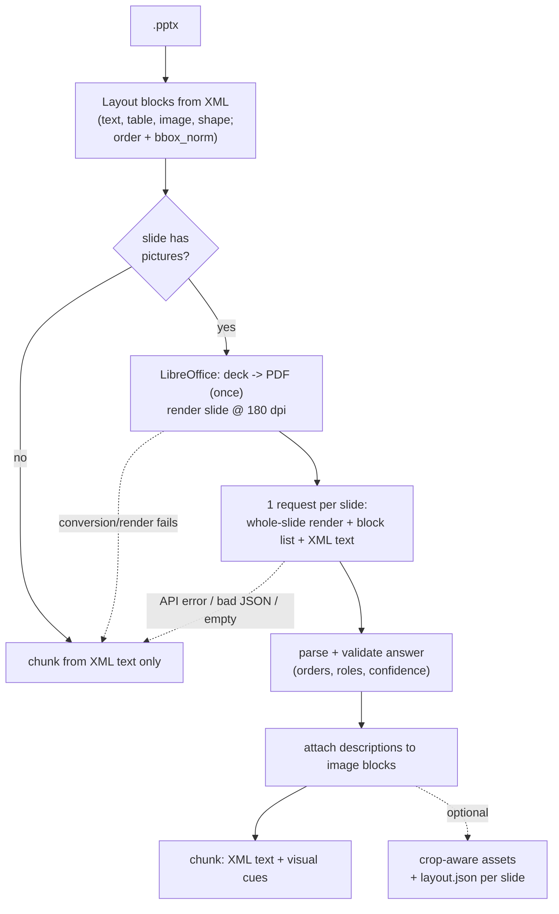

# Slides: software-manual decks

`vlmrag.techniques.slides` turns a `.pptx` software manual into one retrieval chunk per
slide. The slide's text comes from the PPTX XML; a vision-language model (VLM) adds what
the XML cannot say: what each captured screen shows, what role the picture plays on the
slide, and short English and Korean summaries of it.

```bash
python -m vlmrag.synthetic --out work/synth --only slides
vlmrag run slides work/synth/slides --out work/slides.jsonl
python examples/slides_demo.py --provider null      # synthetic deck, offline
```

The chunk format, the VLM client (retries, cache, record/replay, usage), rendering and the
batch runner are shared by all techniques and described in [common.md](common.md). The other
techniques: [drawing](drawing.md), [docx](docx.md). Code: `src/vlmrag/techniques/slides/`,
fixture generator `src/vlmrag/synthetic/slides.py`, demo
[`examples/slides_demo.py`](../../examples/slides_demo.py).

---

## 1. The problem

Software training decks are mostly screenshots. The words a user later searches for - a
screen title, a field value, a button label, a status message, the question a dialog asks -
very often exist **only in the pixels** of those screenshots. A text-only loader indexes the
bullets around the pictures and misses the content of the pictures themselves.

Running OCR or a VLM over the whole slide image fixes recall but breaks precision:

* the text that *is* in the XML (titles, bullets, callout labels, tables) is exact; re-reading
  it from pixels only adds misread characters and wastes tokens;
* a slide is a composition - a main screenshot, an enlarged crop of one region, a dialog
  capture, an icon, plus callouts, arrows and highlight boxes pointing at buttons. A model
  that describes "the image" mixes all of these, describes the red boxes as if they were part
  of the application, and gives no way to tie a description back to a specific picture.

The technique therefore splits the work: **text from XML, pictures described by the model,
tied together by block IDs.**

## 2. Pipeline



### 2.1 Layout blocks from the XML (`layout.py`)

Shapes are walked in reading order - top to bottom, then left to right within each
container - and every shape that carries content becomes a numbered **block**:

| block type | from | content |
|---|---|---|
| `text` | any shape with a non-empty text frame (titles, text boxes, callouts, markers) | one line per paragraph: tabs for the outline level, `- ` as bullet |
| `table` | table graphic frames | plain rows (`a \| b`) and a Markdown table |
| `image` | pictures (including picture placeholders) | source image hash, PowerPoint crop, pixel size |
| `shape` | empty auto shapes, lines/connectors, freeforms, empty text boxes, any shape whose auto-shape type contains `ARROW` | type and auto-shape name only |

Each block has a 1-based `order` (the **block ID** the model refers to) and a
`bbox_norm = {x, y, w, h}` as fractions of the slide size. Group shapes are walked
recursively; their children live in the group's own child coordinate space
(`a:chOff`/`a:chExt`), so they are mapped through the group transform into slide coordinates.
Without that, every block inside a resized group would point at the wrong place on the render.

`shape` blocks exist so the model can *see* that a red rectangle or an arrow is an annotation
(and use it for `related_block_orders` and `flow_notes`) without being asked to describe it.

### 2.2 Rendering

Only slides with at least one picture need the model. For those, the deck is converted to PDF
**once** with headless LibreOffice and the needed pages are rendered at 180 dpi (a 16:9 slide
becomes 2400 x 1350 px: enough to recognise UI elements, small enough to stay cheap).

LibreOffice does not export hidden slides, so the PDF page index is not always
`slide - 1`. Pages are mapped to visible slides in order; when the page count matches neither
the visible nor the total slide count, visual grounding is skipped rather than risk
describing the wrong slide.

### 2.3 One request per slide (`prompt.py`)

| part | content |
|---|---|
| instructions | the grounding prompt (rules + inline schema) |
| context | `Slide context: slide N of M.` |
| slide text | the XML text with Markdown tables, capped at 8,000 characters, labelled "trust this over image OCR" |
| layout blocks | JSON list: `block_order`, `type`, `shape_name`, `bbox_norm`, text (first 600 characters) for text/table blocks, `source_image_id` + crop for image blocks |
| image blocks | the image subset of that list: the blocks that need a description |
| render | the whole-slide PNG, preceded by its label `SLIDE N/M whole-slide render x=0.00-1.00 y=0.00-1.00 dpi=180` |

The model returns:

```json
{"visual_summary": "...",
 "image_descriptions": [{"block_order": 3, "related_block_orders": [4],
   "image_role": "main_screenshot", "description": "...", "description_en": "...",
   "description_ko": "...", "confidence": "high"}],
 "flow_notes": ["..."], "notes": ""}
```

Key rules in the prompt:

* treat the extracted text and layout as the source of truth for any textual value; **no full
  OCR**, no rewriting of long text, no invented text;
* one `image_descriptions` item per meaningful screenshot/captured UI block, with that exact
  `block_order`;
* `image_role` is one of
  * `main_screenshot` - a primary/full application screen (several per slide are fine for
    independent steps),
  * `detail_crop` - an enlarged/cropped part of *another visible* screenshot (not merely
    smaller, not merely cropped in PowerPoint, not merely sharing a source image),
  * `inline_image` - a supporting capture that belongs next to the explanation text,
  * `ui_icon` - a small meaningful UI/app icon;
  when unsure between `main_screenshot` and `detail_crop`, choose `main_screenshot`;
* never describe annotation-only objects (number markers, arrows, callouts, red boxes,
  highlight rectangles, logos/backgrounds), and never mention them in descriptions - describe
  the underlying screen instead;
* include short UI cues (screen title or code, menu, button, tab, field, status, action) in
  `description`, and only the most useful ones in the short summaries;
* `description` is detailed (for retrieval and answering); `description_en` is one sentence
  (two for complex images); `description_ko` says the same in natural Korean;
* `flow_notes` only when arrows, numbering or before/after movement are visually supported;
* when uncertain, stay conservative and lower `confidence`.

The request also carries a strict JSON schema (all properties required, no additional
properties, enums for `image_role` and `confidence`). Servers may ignore it, so the answer is
always parsed defensively (section 4).

### 2.4 Chunks (`chunks.py`)

One chunk per slide that has text, pictures or a visual result; `Chunk.page` is the slide
number in the source deck (empty slides are skipped, never renumbered). Model text (summary,
descriptions, captions, notes) is Unicode-normalised first - NFKC, straight quotes, one dash,
collapsed whitespace - so full-width digits or typographic punctuation in an answer do not break
exact-match filtering.

## 3. Why it is built this way

**Text from XML, not from pixels.** The XML already contains every title, bullet, callout and
table cell exactly. Asking the model not to transcribe keeps answers short (the output budget
is 4,000 tokens per slide) and removes the main source of wrong digits and codes.

**Block IDs and normalised boxes instead of crops.** The relations on a slide - "this enlarged
grid is a crop of that screen", "the arrow points at this button" - are only visible on the
whole slide. Sending the whole render plus the block list lets the model reason about the
composition while answering per block. Because every answer names a `block_order`, the
description can be attached to the right picture, its box and its exported asset without any
coordinate matching on our side.

**`source_image_id` and the crop are sent to the model.** Authors frequently insert the same
screenshot twice: once whole, once cropped and enlarged. The shared source id and the crop
fractions tell the model that two pictures are related; the prompt still reserves
`detail_crop` for pictures the slide *visually* uses as a zoom of another, because a cropped
picture is often simply the main screenshot with its window chrome trimmed.

**One slide per request, run concurrently.** Batching slides would make block IDs ambiguous and
let one bad answer spoil several slides. Requests run in a thread pool; the shared
`VLMClient` enforces the concurrency limit, retries transient errors and caches answers.

**Visual descriptions go into `retrieve_content`.** Metadata is not embedded. A description
that lived only there could never be found, and for screenshot-heavy manuals the description
*is* the searchable content.

**Short bilingual summaries.** The detailed description serves retrieval and the answering
LLM; the one-sentence English and Korean summaries are what a viewer shows as a caption next
to the picture, and they give cross-language queries a second chance to match.

**Annotations are context, not content.** Describing a red box as part of a screen is a
hallucination about the application. Annotation shapes are listed as `shape`/`text` blocks so
the model can use them for `related_block_orders` and `flow_notes`, but they never get a
description of their own.

## 4. Validation and fallbacks

The parser is lenient about shape and strict about content:

| answer | handling |
|---|---|
| fenced JSON, prose around it, a one-element list holding the object | recovered (`extract_json_object`) |
| `block_order` as `"3"`, `3.0`, `"block 3"`, or under `order`/`block`/`block_id` | coerced to `3` |
| `block_order` as a boolean, `Infinity`/`NaN` or a number too large for an integer | unusable (`0`), the item is dropped |
| `related_block_orders` as a scalar, strings, dicts | coerced, de-duplicated, positive only |
| role synonyms (`screenshot`, `zoom`, `supporting image`, `button icon`, ...) | mapped to the four roles |
| unknown role | left empty, never guessed (`invalid_image_role`) |
| confidence outside `low/medium/high` | `low` (`invalid_confidence`) |
| item with `block_order <= 0`, no description, or not an object | dropped (`dropped_descriptions`) |
| `block_order` that is not an image block on the slide | kept, not enriched, flagged (`ungrounded_block_order`) |
| duplicate flow notes (case/whitespace) | de-duplicated |

Nothing in steps 2-5 can fail the file. Each slide falls back to its XML-text chunk and the
reason is recorded in `provenance["fallbacks"]`:

| code | cause |
|---|---|
| `render_unavailable` | LibreOffice missing or the PDF conversion failed (no model calls are made) |
| `page_count_mismatch` | PDF pages cannot be mapped to slides unambiguously |
| `hidden_slide` | the slide is hidden and was not exported |
| `render_failed` | this page could not be rendered |
| `vlm_error` | the call failed after the client's retries (or a non-retryable 4xx) |
| `unparseable_json` | no JSON after one re-ask (two attempts in total) |
| `invalid_json_shape` | JSON, but not an object |
| `parse_error` | the answer could not be validated at all (an unexpected error in the parser) |
| `empty_visual_result` | parsed, but no summary, descriptions, flow notes or notes |
| `slide_parse_error` | the slide's XML could not be walked; the slide keeps its number, and since it then has no content it normally yields no chunk (a warning is logged) |
| `asset_crop_failed`, `asset_vector_conversion_failed`, `asset_write_failed` | asset export problems, including an unwritable `layout.json` (section 6) |

Only a file that cannot be opened as a presentation raises: a missing file
(`FileNotFoundError`), a non-`.pptx` name (`ValueError`), or a package python-pptx cannot
open (`SlidesExtractionError`, which says whether the file is not a zip at all or is an OLE
compound file such as a legacy `.ppt` or an encrypted deck). The CLI records it in
`<out>.errors.jsonl` and continues with the next file.

## 5. Defaults

| setting | value | where |
|---|---|---|
| render resolution | 180 dpi, whole slide | `pipeline.RENDER_DPI` |
| requests | 1 per slide with pictures | `pipeline.extract` |
| request timeout | 240 s | `pipeline.VLM_TIMEOUT_S` |
| max output tokens | 4,000 | `pipeline.VLM_MAX_OUTPUT_TOKENS` |
| re-ask on empty/unparseable answer | 1 (2 attempts) | `pipeline.PARSE_RETRIES` |
| transport retries | `VLMRAG_MAX_RETRIES` (default 3) | `VLMClient` |
| reasoning effort | `VLMRAG_REASONING_EFFORT` (default `low`) | `Settings` |
| slide text sent | first 8,000 characters | `prompt.SLIDE_TEXT_LIMIT` |
| text per block sent | first 600 characters | `prompt.BLOCK_TEXT_LIMIT` |
| PPTX -> PDF / metafile -> PNG conversion timeout | 60 s | `pipeline.CONVERT_TIMEOUT_S` |
| concurrency | `min(slides with pictures, client.max_concurrency)` workers (`VLMRAG_MAX_CONCURRENCY`); the client's semaphore is the actual limit | `pipeline.extract` |
| prompt version | `slides.visual/1` | `prompt.PROMPT_VERSION` |

## 6. Output

### `retrieve_content`

```
slide=4 | title=3. Release the order
- 3. Release the order
- Select the order in the list and choose the action shown by the icon.
- Answer the confirmation prompt.
[Visual image retrieval cues]
Visual summary: Order list, the release icon and the confirmation dialog.
Image detailed description: Confirmation dialog 'Release order' asking 'Release order PO-1050 to the vendor?' ...
Image role: inline_image
Image display summary EN: Dialog asking to release order PO-1050 to the vendor.
Image display summary KO: ...
```

Tables appear as plain rows here (`Draft | Saved, not yet sent`), not as Markdown.

### `llm_content`

```
[Source]
source: sample_erp_manual.pptx
slide: 4
title: 3. Release the order

<slide text, tables as Markdown>

[Grounded visual description]
<visual summary>
- image block 5 (related blocks: 2): description=...; summary_en=...; summary_ko=...; image_role=inline_image [confidence=high]
- flow: ...
- notes: ...
```

### `filtering_content`

`retrieve_content` with all whitespace removed.

### `metadata`

| key | meaning |
|---|---|
| `slide_title` | text of the title placeholder |
| `slide_count`, `hidden` | deck size; whether the slide is hidden |
| `has_images`, `image_count` | pictures on the slide |
| `visual_used` | whether any visual result was folded in |
| `visual_summary`, `flow_notes`, `visual_notes` | the validated answer |
| `image_descriptions` | per described block: `block_order`, `related_block_orders`, `image_role`, `description`, `description_en`, `description_ko`, `confidence`, plus the block's `shape_id`, `shape_name`, `bbox_norm`, `crop_norm`, `crop_area_norm`, `source_image_id` and, with assets, `asset` |
| `layout` | `slide_size` (EMU) and every block (`order`, `type`, position in EMU, `bbox_norm`, text, picture info) |
| `image_assets` | with `asset_dir`: per image block the relative asset path, format, whether it was cropped/converted, and asset fallbacks |

### `provenance`

The shared keys (see [common.md](common.md#1-dual-representation)): `technique`, `model`,
`backend`, `prompt_versions` (`{"slides.visual": "slides.visual/1"}` when the slide was sent,
else empty), `calls` (one record when the slide was sent: task, prompt version, `status`
`ok` / `empty` / `error` / `unparseable` / `invalid`, backend, model, `cached`, `latency_s`, token
`usage`, or the error) and `fallbacks`. For slides with pictures also `render` (`dpi`,
`converter`, `pdf_page`), `visual_call` (the same status record, or why the slide was not
sent), `request` (timeout, token limit, reasoning effort, re-asks, text limits) and
`visual_issues` (the parser's detailed notes). Slides without pictures record
`visual_call = {"status": "skipped", "reason": "no_images"}` and no calls.

### Crop-aware assets (optional)

`extract(path, client, settings, asset_dir=DIR)` (or `--assets DIR` in the demo) writes, for
every slide with pictures, `DIR/<deck stem>-<first 8 hex of doc_id>/slide_NNN/img_NNN.<ext>` and a
`layout.json` (slide size, blocks, assets, and the visual answer with the same enriched
`image_descriptions` as the chunk metadata). The content hash in the folder name keeps two decks
that share a file name from overwriting each other's assets; a non-ASCII stem is reduced to the
hash alone, so paths stay portable. An asset is the **visible** region of the
picture: the PPTX stores the full source image even when the author cropped it, so the crop
fractions are applied to the source pixels. WMF/EMF pictures are converted to PNG with
LibreOffice; because LibreOffice exports a metafile as a whole page with the graphic placed on
it, the uniform page margin is trimmed before the crop is applied. A crop that cannot be
applied keeps the full image; a metafile that cannot be converted keeps its original bytes.

## 7. Synthetic fixture

`python -m vlmrag.synthetic --out DIR --only slides` writes `DIR/slides/sample_erp_manual.pptx`
(six slides of an invented ERP manual) and `DIR/slides/sample_erp_manual.truth.json`:

* slide 1 and 6: text only (no model call expected);
* slide 2: an order-entry screenshot with a red highlight box, a numbered marker and an arrow
  pointing at a button (annotations must not be described);
* slide 3: a screenshot and the same image cropped and enlarged (`detail_crop`);
* slide 4: a screenshot, a small dialog capture (`inline_image`) and an icon (`ui_icon`);
* slide 5: a native table and a screenshot inside a *scaled* group.

The truth file lists per slide the expected roles (keyed by shape name, since block IDs are an
output), annotation shapes, facts visible only in the pictures, must-mention facts, and
retrieval queries whose answers exist **only in the pixels** - the tests assert that none of
them appears in the XML text. The deck is generated from a minimal hand-written package
skeleton with fixed timestamps, so the same seed always produces the same bytes (and the same
`doc_id` and cache keys).

## 8. Limitations

* `.ppt` (binary PowerPoint) is not read; convert it to `.pptx` first.
* Rendering needs LibreOffice. Its rendering of some PowerPoint effects, fonts and SmartArt
  differs from PowerPoint's; the model sees LibreOffice's version.
* Charts and SmartArt are neither text nor picture blocks; their content is only visible to
  the model as part of the render, and no description is attached to them.
* Rotated and flipped shapes keep their unrotated bounding box.
* Image roles come from the model only. A missing or unknown role is left empty rather than
  guessed from geometry.
* Speaker notes are not read.
* A description whose `block_order` points at a non-image block is kept (it may still be a
  correct description of what is visible) and flagged, not repaired.
* Metafile assets are trimmed by colour (the colour of the top-left pixel). A metafile whose
  own drawing has a blank border loses that border too, so a PowerPoint crop applied
  afterwards can be off by the width of that border.
